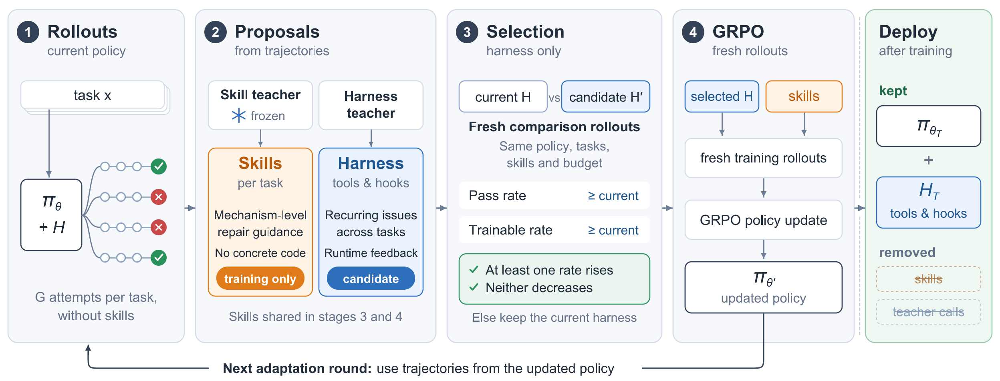

# HarnessAdapt-RL

### Training the Whole Agent, Not Just the Model

[](https://arxiv.org/abs/2610.28069)
[](https://huggingface.co/anon-review-7f3a/HarnessAdapt-RL)

Code and artifacts for [*Training the Whole Agent, Not Just the Model*](https://arxiv.org/abs/2610.28069).

HarnessAdapt-RL trains a coding agent's policy **and adapts its harness during reinforcement learning**. Current-policy trajectories guide two complementary forms of adaptation: task-specific mechanism-level skills for repair strategies, and evolving tools and runtime hooks for recurring interaction problems. The result is a **model–harness pair**, not just a trained model.

[Paper](https://arxiv.org/abs/2610.28069) · [Model weights](https://huggingface.co/anon-review-7f3a/HarnessAdapt-RL) · [Quickstart](#quickstart) · [Training and evaluation](#training-and-evaluation) · [Citation](#citation)

## Overview

[](assets/figures/harnessadapt-overview.pdf)

1. **Generate mechanism-level skills.** A frozen teacher compares training trajectories and explains when and why a repair strategy applies, without providing concrete code changes.
2. **Evolve tools and hooks.** A separate teacher identifies recurring interaction problems across tasks and implements candidate harness changes.
3. **Select for success and trainability.** Keep a candidate only if it improves the observed pass rate or trainable rate without lowering either. The trainable rate measures the fraction of sampled rollouts usable for policy updates; this selection rule is not a statistical significance test.
4. **Train and repeat.** Update the policy with GRPO on fresh rollouts under the selected harness. New trajectories guide subsequent adaptation, producing the first-epoch harness **H1** and second-epoch harness **H2**.

At deployment, retain the trained policy and **H2**, but remove task-specific training skills. No teacher calls or further harness updates are needed. General harness instructions remain part of the runtime; they are distinct from temporary task-specific skills.

## Results

Using **Qwen3.5-9B** as the base model, HarnessAdapt-RL improves pass@1 over mini-swe-agent + GRPO on all three repair benchmarks and also outperforms OpenHands-GRPO.

| Method | SWE-bench Verified | SWE-bench Multilingual | SWE-bench Pro | Average |
| --- | ---: | ---: | ---: | ---: |
| Base model + mini-swe-agent | 42.2 | 19.3 | 31.8 | 31.1 |
| mini-swe-agent + GRPO | 47.8 | 24.7 | 33.3 | 35.3 |
| OpenHands-GRPO | 51.4 | 33.3 | 32.3 | 39.0 |
| **HarnessAdapt-RL** | **57.6** | **37.3** | **39.7** | **44.9** |
| **Improvement over GRPO (pp)** | **+9.8** | **+12.6** | **+6.4** | **+9.6** |

Scores are mean pass@1 (%) across three evaluation runs of each fixed checkpoint, not three independent training runs. Average is the unweighted mean across benchmarks. All configurations are evaluated without task-specific skills or teacher assistance and retain their respective deployment harnesses. The GRPO baseline uses twice as many policy-training rollouts as HarnessAdapt-RL; see the paper for the full setup and cost accounting.

The paper also finds that gains from mechanism-level skills persist after their removal, while removing evolved tools and hooks at evaluation reduces pass@1 by up to **7.7 percentage points**. Use the trained policy together with H2 to preserve the complete agent's performance.

## Repository Structure

| Path | Contents |
| --- | --- |
| [src/harnessadapt/](src/harnessadapt/) | Policy runtime, inference, training, harness evolution, and benchmark evaluation |
| [harnesses/h1/](harnesses/h1/) | First-epoch harness: seven added tools and four runtime hooks |
| [harnesses/h2/](harnesses/h2/) | Final deployment harness: eight added tools and five runtime hooks |
| [data/](data/) | 1,058 training task IDs and the two-epoch sampling schedule |
| [prompts/](prompts/) | Skill-generation and harness-proposal teacher prompts |
| [examples/](examples/) | Source preparation, model serving, training, and task inference scripts |
| [integrations/](integrations/) | Pinned training-container and OpenHands integration assets |
| [docs/](docs/) | Environment setup, artifact specifications, and packaging notes |

Model weights and benchmark task images are **not bundled in this Git repository**. Download the deployment checkpoint separately; task data and images must be prepared for your environment.

## Quickstart

### 1. Install host dependencies

Use **Python 3.11 on Linux x86-64**. Local model serving requires a running Docker daemon, NVIDIA GPUs, and NVIDIA Container Toolkit. The default serving script uses four-way tensor parallelism; set `HARNESSADAPT_TP` to match your GPU configuration and available memory. This is not a CPU-only or macOS serving setup.

Run the following commands from the repository root after cloning:

```bash
python3.11 -m venv .venv
source .venv/bin/activate
python -m pip install -r requirements.txt
```

### 2. Download the trained policy

Download the Hugging Face checkpoint into the location expected by the serving and inference scripts:

```bash
python - <<'PY'
from huggingface_hub import snapshot_download

snapshot_download(
    repo_id="anon-review-7f3a/HarnessAdapt-RL",
    local_dir="models/update45",
)
PY
```

The checkpoint contains approximately 19.3 GB of model weights. This is the trained **deployment** policy, not the base model used to start a new training run.

### 3. Start the model server

```bash
bash examples/serve.sh
```

The default OpenAI-compatible endpoint is `http://127.0.0.1:31980/v1`, with served model name `harnessadapt-update45`. Wait for the server to finish loading before running a task.

To use a checkpoint stored elsewhere, set `HARNESSADAPT_CHECKPOINT` for serving and pass the same path via `--checkpoint` when running inference.

### 4. Run a repair task with H2

In another terminal, activate the same virtual environment and run:

```bash
bash examples/run_task.sh \
  --harness h2 \
  --task-image YOUR_PREPARED_TASK_IMAGE \
  --issue-file /absolute/path/to/issue.txt \
  --output-dir outputs/example
```

Replace the image and issue-file placeholders with your task inputs. The prepared image must contain the task's starting Git repository at `/testbed`; the issue file contains the repair request. Use a new output directory for each attempt.

The runner saves `run_config.json`, `result.json`, and, on successful submission, `submission.patch`. It **does not run the benchmark grader**: a submitted patch is not evidence that the task's tests passed. For benchmark-specific preparation and scoring, follow the setup guide below. Use `--harness h1` to run the first-epoch harness instead.

## Training and Evaluation

Follow the [training environment setup guide](docs/TRAINING_SETUP.md) to prepare pinned sources, build the GPU runtime, download and convert the original base model, configure teacher access, prepare task images, and run training and benchmark evaluation. Training uses eight visible GPUs in the documented setup; teacher access is required for teacher-assisted training, but not deployment inference.

Once the environment and required inputs are prepared, the main training entry points are:

```bash
bash examples/train.sh prepare --recipe harnessadapt_rl --run-dir outputs/runs/harnessadapt_rl
bash examples/train.sh preflight --run-dir outputs/runs/harnessadapt_rl --check-environment
bash examples/train.sh train --run-dir outputs/runs/harnessadapt_rl --stop-after 46
```

See [artifact specifications](docs/ARTIFACT_NOTES.md) for the correspondence between code, data, harnesses, and the paper. The setup guide also documents recovered source pins and reproducibility limitations. These setup scripts and container builds still need validation on the target GPU host; the README commands are not an end-to-end reproduction guarantee.

## Citation

If you use HarnessAdapt-RL, its code, model, or evolved harnesses in your research, please cite:

```bibtex
@misc{tang2026trainingwholeagent,
  title         = {Training the Whole Agent, Not Just the Model},
  author        = {Lingxiao Tang and Wei Tao and Yiwen Guo and Lingfeng Bao},
  year          = {2026},
  eprint        = {2610.28069},
  archivePrefix = {arXiv},
  primaryClass  = {cs.SE},
  url           = {https://arxiv.org/abs/2610.28069}
}
```

## License

A license for the project-authored code has not yet been selected; see [license status](LICENSE_PENDING.txt). Publication of the repository does not grant a blanket license for that code. Model weights and third-party dependencies remain subject to their respective licenses.
